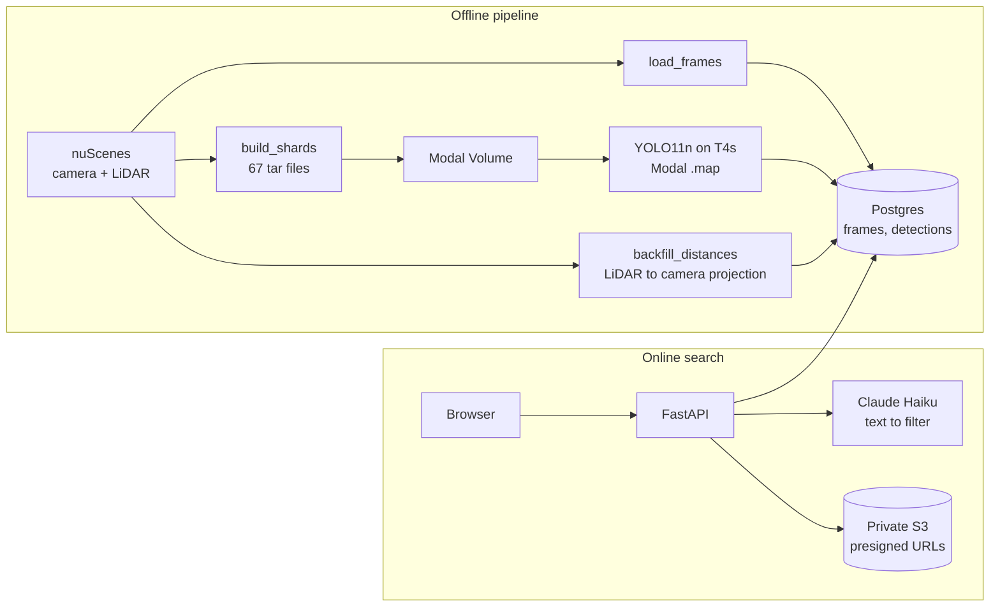

# av-log-search

Natural-language search over self-driving footage. Ask for "pedestrian within 10 m at night" and get the matching nuScenes front-camera frames, with the objects boxed and their distance from the car.

## How it works

1. Loads 34,149 front-camera keyframes from all 850 nuScenes trainval scenes into Postgres.
2. Runs a pretrained YOLO11n (COCO, not trained by me) on Modal T4 GPUs and stores 299,170 detections.
3. Projects each LiDAR sweep into the camera image. An object's distance is the 25th percentile range of the points in the middle 75% of its box (at least 3 points).
4. Claude Haiku turns the query into a small JSON filter that Pydantic validates, with retries and a keyword fallback. The filter becomes parameterized SQL, so model output never becomes SQL text.
5. FastAPI serves results and a one-page UI, deployed on EC2 with Docker Compose. Images come from a private S3 bucket via presigned URLs.

## Architecture



## Results

From real runs, logged in [NOTES.md](NOTES.md).

| Metric | Result |
|---|---|
| Detection throughput | 234-240 fps per T4 (batch 16, images in memory) |
| Full detection run | 451 fps end to end, ~32K frames in 71 s |
| Distance error (val split, 10,157 objects) | 0.46 m median, 3.22 m p90 |
| Search precision@10 (20 queries vs. labels) | 0.86 (0.89 lenient) |
| LLM parse accuracy | 20/20 |
| Database latency (1,000 searches) | p50 4.5 ms, p95 11.4 ms |
| Text search latency (200 searches) | p50 762 ms, p95 1.24 s (97% LLM) |
| Index on (class, distance) | 8.36 ms to 0.96 ms |
| Kill and resume | same totals as an uninterrupted run |

GPU cost of the full run: TODO

## Run it locally

Needs Python 3.12, Docker, a Modal account, an Anthropic API key, and nuScenes trainval (free account at nuscenes.org, non-commercial license).

```bash
python3.12 -m venv .venv && source .venv/bin/activate
python -m pip install -r requirements.txt
echo "ANTHROPIC_API_KEY=your-key" > .env

docker compose up -d db
python -m scripts.load_frames
python -m scripts.build_shards
python -m modal volume create nuscenes-frames
python -m modal volume put nuscenes-frames data/shards /shards
python -m modal run detect/run_detections.py
python -m scripts.backfill_distances

docker compose up -d --build api
open http://127.0.0.1:8000/
```

Tests and evals:

```bash
python -m pytest -v
python -m evaluation.distance_validation
python -m evaluation.precision
python -m evaluation.latency
```

## Data

[nuScenes](https://www.nuscenes.org) by Motional, CC BY-NC-SA 4.0. Non-commercial portfolio project; the dataset is not included.
